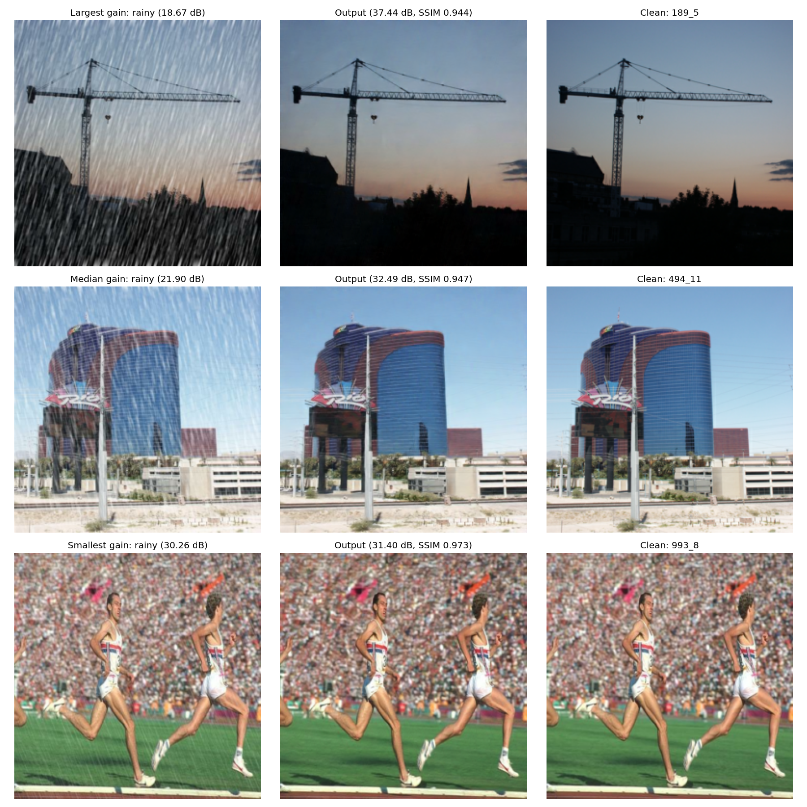
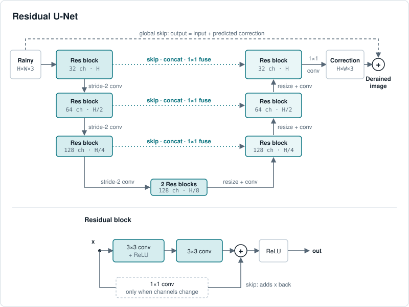
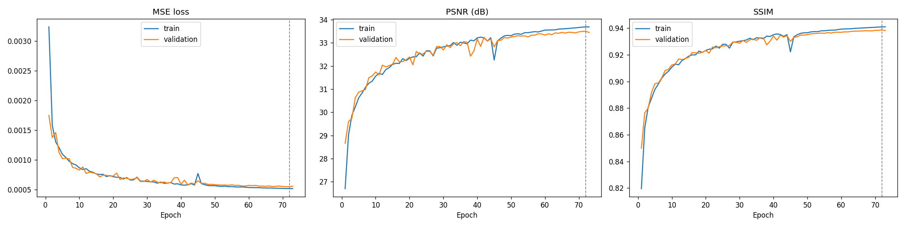
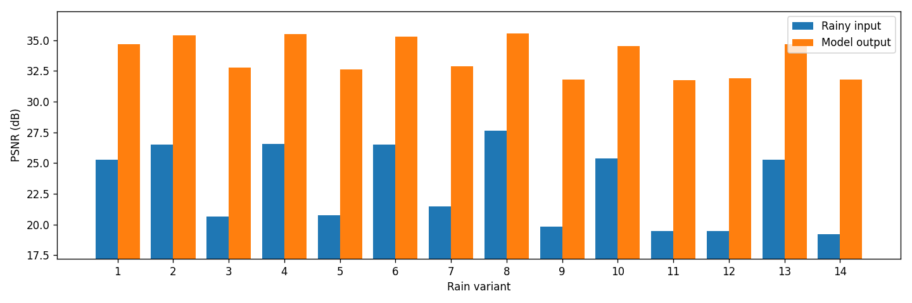

# Real-Time Image Deraining with a Residual U-Net

Rain degrades every camera that has to work outdoors. Streaks and drops hide edges, text and objects, and vision models trained on clear-weather images quietly lose accuracy. Autonomous driving, traffic and security cameras, and drones all rely on clean frames, and removing rain before those frames reach the downstream models restores much of the lost signal, provided the cleanup keeps pace with the camera.

## Problem

Single-image deraining takes a rainy frame and predicts the clean scene behind it. State-of-the-art models such as Restormer reach high accuracy with tens of millions of parameters and heavy attention layers, which puts them outside the per-frame budget of real-time systems such as a driving perception stack or a live video feed. A model used there has to run at camera rate (about 30 FPS at 720p) on modest hardware while still removing enough rain to help the tasks downstream.

This project trains a 1.9 M-parameter residual U-Net in TensorFlow that runs at **30.6 FPS at 1280×720 on an NVIDIA T4** and improves PSNR by **10.5 dB** over the rainy input, within about 0.5 dB of models up to 14× larger.

Test images with the largest, median and smallest PSNR gain. The smallest gain occurs on images with very little rain to begin with.

## Architecture

The network predicts a **correction** that is added back to the input (global skip), so it only has to learn what to remove rather than redraw the whole scene.

- **Encoder:** three stride-2 convolutions halve the resolution down to 1/8, widening from 32 to 128 channels. The coarse levels see enough context to tell rain streaks from real edges.
- **Decoder:** bilinear resize followed by a convolution doubles the resolution back. This avoids the checkerboard artifacts of transposed convolutions.
- **Skip connections:** encoder features are concatenated into the decoder and fused with a 1×1 convolution, which restores fine detail lost during downsampling.
- **Residual blocks:** every stage is two 3×3 convolutions with an identity shortcut, which keeps gradients stable and training fast.
- **Fully convolutional:** trained on 256×256 images, it runs on any frame whose sides divide by 8, including 720p, without changes.

## Results

Trained on 11,200 rainy/clean pairs (800 scenes × 14 rain types) and evaluated on 1,400 pairs from 100 held-out scenes. Scenes are split before pairing, so no background appears in both training and test.

| | PSNR (dB) | SSIM |
|---|---|---|
| Rainy input | 23.13 | 0.759 |
| **Model output** | **33.66** | **0.941** |
| Gain | +10.52 | +0.182 |

**Latency** (batch 1, XLA, mixed precision, NVIDIA T4, median of 100 runs):

| Resolution | Latency | Throughput |
|---|---|---|
| 256×256 | 3.0 ms | 333 FPS |
| 640×480 | 11.1 ms | 90 FPS |
| 1280×720 | 32.7 ms | 30.6 FPS |

### Comparison with published models

Published results on Test2800, the test split of Rain14000, a 14,000-image set from the same authors built the same way (1,000 scenes × 14 rain types):

| Model | Params | PSNR (dB) | SSIM |
|---|---|---|---|
| PReNet (CVPR 2019) | 0.2 M | 31.75 | 0.916 |
| MSPFN (CVPR 2020) | 13.4 M | 32.82 | 0.930 |
| MPRNet (CVPR 2021) | 3.6 M | 33.64 | 0.938 |
| Restormer (CVPR 2022) | 26.1 M | 34.18 | 0.944 |
| **Residual U-Net (this project)** | **1.9 M** | **33.66** | **0.941** |

At face value the model matches MPRNet with half its parameters and comes within 0.5 dB of Restormer at about 1/14 of its size, while running in real time at 720p. Accuracy differences between these architectures are measured in tenths of a dB, while the cost difference is an order of magnitude; for real-time use, the smaller model is the better trade.

The comparison is indicative rather than exact, because the evaluation setups differ:

- **Color channel:** published scores use only the luminance (Y) channel, which ignores color errors and usually gives a higher PSNR than the RGB score used here.
- **Resolution:** published scores use full-resolution images. This project resizes to 256×256, which blurs thin streaks and fine texture and makes the task somewhat easier.
- **Test images:** Test2800 has 200 scenes; this project tests on 100 different held-out scenes from its own split.
- **Training data:** most published models train on Rain13K, a larger mix of several datasets, while this model trains only on the 11,200 pairs from its own split.

These differences push in opposite directions, so the gap to each model should be read as approximate. Scoring the model on Test2800 at full resolution on the Y channel would give a like-for-like number.

Training and validation curves stay within 0.2 dB of each other throughout, so the model is not overfitting. Training used mixed precision and diverged to NaN after epoch 73; the checkpoint from epoch 72, the best validation epoch, is the one evaluated here.

Heavy-rain variants start near 19 dB and gain the most (about 12.5 dB). Light rain is restored to above 35 dB.

## Repository

| Path | Purpose |
|---|---|
| `derain.ipynb` | End-to-end pipeline: data download and split, `tf.data` input pipeline, model, training, test evaluation, per-rain-type analysis, latency benchmark and export. Runs on Kaggle (GPU T4 ×2, internet on). |
| `derain_outputs/best_model.keras` | Trained model (architecture and weights). |
| `derain_outputs/best_model.weights.h5` | Weights only, for loading into a rebuilt model. |
| `derain_outputs/summary.json` | Key metrics from the training run. |
| `derain_outputs/history.csv` | Per-epoch loss, PSNR and SSIM for training and validation. |
| `derain_outputs/test_results.csv` | PSNR and SSIM for every test image, before and after deraining. |
| `derain_outputs/split.csv` | Train, validation and test assignment of every scene. |
| `derain_outputs/*.png` | Test examples, training curves and per-rain-type results. |
| `assets/architecture.svg` | Architecture diagram. |
| `image_processing.ipynb` | Earlier experiments with classical (non-learning) deraining filters. |

## Usage

Upload `derain.ipynb` to Kaggle, select GPU T4 ×2, turn on internet access and run all cells. Training and evaluation take under 2 hours, and all outputs are written to `/kaggle/working/outputs`.

## Data and credits

- Dataset: 1,000 clean images with 14 synthetic rain variants each, from Fu et al., *Clearing the Skies: A Deep Network Architecture for Single-Image Rain Removal* (IEEE TIP 2017), via [jinnovation/rainy-image-dataset](https://github.com/jinnovation/rainy-image-dataset).
- Comparison figures: [MSPFN](https://arxiv.org/abs/2003.10985), [MPRNet](https://arxiv.org/abs/2102.02808), [Restormer](https://arxiv.org/abs/2111.09881) and the survey [Towards Unified Deep Image Deraining](https://arxiv.org/abs/2310.03535).
